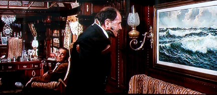

# Dzigurski Bench

A single-image meme benchmark testing whether multimodal models can identify a frame from Sergio Leone's [*Once Upon a Time in the West*](https://en.wikipedia.org/wiki/Once_Upon_a_Time_in_the_West) and whether they will use reverse image search if offered. The frame shows railroad baron Morton (Gabriele Ferzetti) standing before a seascape by Serbian-American painter Alexander Dzigurski in his private railway car, with Frank (Henry Fonda) seated in the background. This exact frame appears on numerous publicly indexed websites.

Motivated by an amusing [repeated](https://muddy.jprs.me/posts/2026-08-24-i-am-once-again-reminded-that-llms-don-t-really-see-anything/) [failure](https://muddy.jprs.me/posts/2026-09-30-knowing-when-not-to-guess/) of GPT-5.6 Sol to correctly identify the frame in question.

Twelve models (mostly picked from OpenRouter's top 20 on October 14, 2026) were given the following prompt under three conditions, with one run per model per condition (36 trials in total):

**What film is this image from?**



| Condition | Tools available |
|---|---|
| `vision` | None |
| `web` | OpenRouter web search and page fetch |
| `web+lens` | Web search, page fetch, and `reverse_image_search()` |

`reverse_image_search()` returns five cached visual matches collected from a Google Lens search performed on October 14, 2026 and stored in a convenient format as `lens.json`. These results plainly identify the origin of the frame. The description of the tool is given as: "Find visually matching webpages for the supplied image."

Models were not instructed to abstain when uncertain or to use any particular tool. Tool selection was left to the models.

## Run

Python 3.10+:

```bash
pip install requests
export OPENROUTER_API_KEY='example-key'
python bench.py --condition vision
python bench.py --condition web
python bench.py --condition web+lens
```

By default, each command runs all 12 models under the specified condition.

## Outputs

- `results/results.csv`: final answers, reported web search counts, Lens calls, cost, and elapsed time.
- `results/*.jsonl`: raw API request and response bodies, tool calls and results, errors, and final trial records, written as the experiment progresses.
- `results/manifest.json`: prompt and input-file hashes.

## Results

The below tables summarize the results of a run from October 14, 2026.

### `vision`

| Model | Film identified | Cost (USD) |
|---|---|---:|
| DeepSeek V4.1 Flash | [Theatre of Blood (1973)](https://en.wikipedia.org/wiki/Theatre_of_Blood) | $0.000736 |
| GLM 5.3 Flash | None | $0.018143 |
| GPT-6.1 Sol | [20,000 Leagues Under the Sea (1954)](https://en.wikipedia.org/wiki/20,000_Leagues_Under_the_Sea_(1954_film)) | $0.001928 |
| GPT-5.6 Sol | [20,000 Leagues Under the Sea (1954)](https://en.wikipedia.org/wiki/20,000_Leagues_Under_the_Sea_(1954_film)) | $0.015356 |
| Claude Sonnet 5.5 | None | $0.006380 |
| Claude Opus 5.5 | None | $0.014840 |
| Kimi K3 | [Murder on the Orient Express (1974)](https://en.wikipedia.org/wiki/Murder_on_the_Orient_Express_(1974_film)) | $0.160083 |
| Gemini 3.8 Flash | [20,000 Leagues Under the Sea (1954)](https://en.wikipedia.org/wiki/20,000_Leagues_Under_the_Sea_(1954_film)) | $0.002664 |
| Gemini 4 Argon | [Monte Carlo or Bust! (1969)](https://en.wikipedia.org/wiki/Monte_Carlo_or_Bust!) | $0.003520 |
| Qwen3.8 Max (0902) | [Titanic (1997)](https://en.wikipedia.org/wiki/Titanic_(1997_film)) | $0.064516 |
| Muse Wonder | [The Poseidon Adventure (1972)](https://en.wikipedia.org/wiki/The_Poseidon_Adventure_(1972_film)) | $0.091432 |
| Grok 4.7 | [The Godfather (1972)](https://en.wikipedia.org/wiki/The_Godfather) | $0.004748 |

### `web`

| Model | Film identified | Cost (USD) | Web searches |
|---|---|---:|---:|
| DeepSeek V4.1 Flash | None | $0.051218 | 7 |
| GLM 5.3 Flash | None | $0.073758 | 7 |
| GPT-6.1 Sol | [20,000 Leagues Under the Sea (1954)](https://en.wikipedia.org/wiki/20,000_Leagues_Under_the_Sea_(1954_film)) | $0.034853 | 2 |
| GPT-5.6 Sol | [20,000 Leagues Under the Sea (1954)](https://en.wikipedia.org/wiki/20,000_Leagues_Under_the_Sea_(1954_film)) | $0.164912 | 7 |
| Claude Sonnet 5.5 | None | $0.010646 | 0 |
| Claude Opus 5.5 | [The Sting (1973)](https://en.wikipedia.org/wiki/The_Sting) | $0.024171 | 0 |
| Kimi K3 | None | $0.608924 | 6 |
| Gemini 3.8 Flash | [Once Upon a Time in the West (1968)](https://en.wikipedia.org/wiki/Once_Upon_a_Time_in_the_West) | $0.063134 | 5 |
| Gemini 4 Argon | [Jules Verne's Rocket to the Moon (1967)](https://en.wikipedia.org/wiki/Jules_Verne%27s_Rocket_to_the_Moon) | $0.119446 | 5 |
| Qwen3.8 Max (0902) | [Titanic (1997)](https://en.wikipedia.org/wiki/Titanic_(1997_film)) | $0.195606 | 6 |
| Muse Wonder | [20,000 Leagues Under the Sea (1954)](https://en.wikipedia.org/wiki/20,000_Leagues_Under_the_Sea_(1954_film)) | $0.257190 | 5 |
| Grok 4.7 | [The Deep (1977)](https://en.wikipedia.org/wiki/The_Deep_(1977_film)) | $0.390136 | 10 |

### `web+lens`

| Model | Film identified | Cost (USD) | Web searches | Lens searches |
|---|---|---:|---:|---:|
| DeepSeek V4.1 Flash | [Once Upon a Time in the West (1968)](https://en.wikipedia.org/wiki/Once_Upon_a_Time_in_the_West) | $0.018096 | 3 | 1 |
| GLM 5.3 Flash | [Once Upon a Time in the West (1968)](https://en.wikipedia.org/wiki/Once_Upon_a_Time_in_the_West) | $0.000828 | 0 | 1 |
| GPT-6.1 Sol | [Once Upon a Time in the West (1968)](https://en.wikipedia.org/wiki/Once_Upon_a_Time_in_the_West) | $0.007930 | 0 | 1 |
| GPT-5.6 Sol | [Once Upon a Time in the West (1968)](https://en.wikipedia.org/wiki/Once_Upon_a_Time_in_the_West) | $0.007732 | 0 | 1 |
| Claude Sonnet 5.5 | [Once Upon a Time in the West (1968)](https://en.wikipedia.org/wiki/Once_Upon_a_Time_in_the_West) | $0.006450 | 0 | 1 |
| Claude Opus 5.5 | [Once Upon a Time in the West (1968)](https://en.wikipedia.org/wiki/Once_Upon_a_Time_in_the_West) | $0.018039 | 0 | 1 |
| Kimi K3 | [Once Upon a Time in the West (1968)](https://en.wikipedia.org/wiki/Once_Upon_a_Time_in_the_West) | $0.010251 | 0 | 1 |
| Gemini 3.8 Flash | [Once Upon a Time in the West (1968)](https://en.wikipedia.org/wiki/Once_Upon_a_Time_in_the_West) | $0.002998 | 0 | 1 |
| Gemini 4 Argon | [Once Upon a Time in the West (1968)](https://en.wikipedia.org/wiki/Once_Upon_a_Time_in_the_West) | $0.008538 | 0 | 1 |
| Qwen3.8 Max (0902) | [Once Upon a Time in the West (1968)](https://en.wikipedia.org/wiki/Once_Upon_a_Time_in_the_West) | $0.010698 | 0 | 1 |
| Muse Wonder | [Once Upon a Time in the West (1968)](https://en.wikipedia.org/wiki/Once_Upon_a_Time_in_the_West) | $0.039633 | 0 | 1 |
| Grok 4.7 | [Once Upon a Time in the West (1968)](https://en.wikipedia.org/wiki/Once_Upon_a_Time_in_the_West) | $0.017354 | 1 | 1 |
